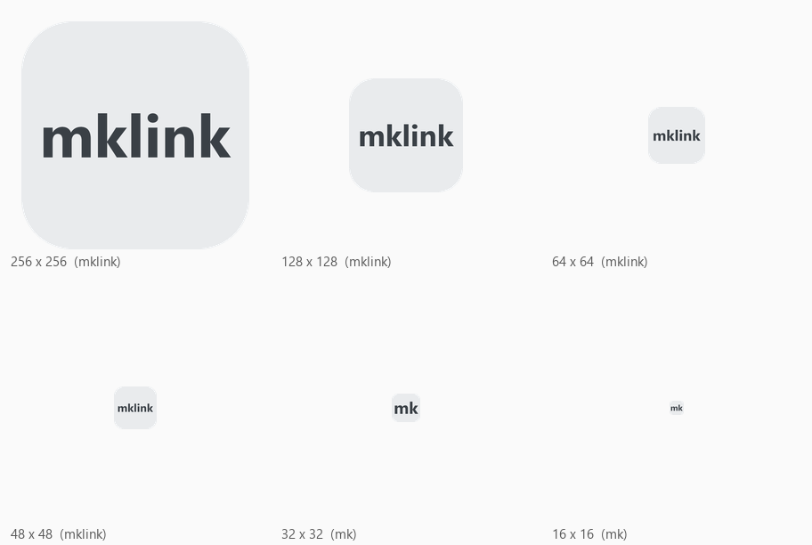
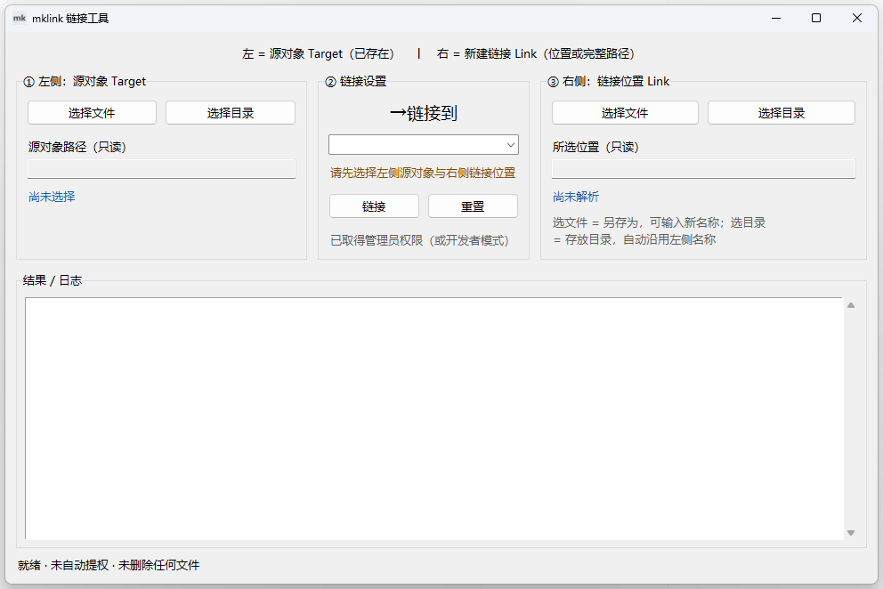

# mklink 链接工具


<p align="center"></p>

一个 Windows 桌面小工具：**把一份文件或目录"链接到"另一个位置，对程序表现为完整可用的文件/目录，但磁盘上只存一份数据**。

它把 `mklink` 的四种参数（`/H`、无参数、`/D`、`/J`）做成了图形界面，按对象类型与是否跨卷自动推荐合法参数，用户可手动覆盖，全部操作遵循「只提示不改动」。



---

## 目录

- [为什么需要它](#为什么需要它)
- [功能特性](#功能特性)
- [安装与运行](#安装与运行)
- [界面与操作步骤](#界面与操作步骤)
- [四种链接类型](#四种链接类型)
- [自动推荐规则](#自动推荐规则)
- [典型用途](#典型用途)
- [安全策略](#安全策略)
- [注意事项与局限](#注意事项与局限)
- [常见问题](#常见问题)
- [从源码打包](#从源码打包)
- [环境要求与技术栈](#环境要求与技术栈)
- [仓库结构](#仓库结构)
- [许可证](#许可证)

---

## 为什么需要它

很多程序把数据路径写死在配置里，或者要求数据必须放在自己的目录下。于是同一份几 GB 的大模型、同一套投标资料，常常被复制到三四个位置：既浪费磁盘，又容易出现「改了 A 处忘了 B 处」。

NTFS 的链接机制可以解决这个问题：

```text
一份实体数据（磁盘仅存一份）
├─ D:\AI\models\qwen.safetensors        ← 实体文件
├─ D:\ComfyUI\models\qwen.safetensors   ← /H 硬链接（同卷）
└─ E:\WebUI\models\qwen.safetensors       ← 无参数 符号链接（跨卷）
```

问题在于：`mklink` 是 `cmd.exe` 内置命令，参数顺序是 `<Link> <Target>`（链接在前、目标在后），四种参数各有适用条件，且符号链接需要管理员权限。手工操作容易写反、选错参数、或把目录递归删除穿透到目标。

本工具把这些判断固化成了界面。

---

## 功能特性

- **四种参数全覆盖**：硬链接 `/H`、文件符号链接（无参数）、目录符号链接 `/D`、目录联接 `/J`。
- **自动推荐 + 可手动改**：按「源对象是文件还是目录」「左右是否同卷」「是否 UNC」选出唯一合法或最优参数；下拉框只列合法项，被禁用项用文字说明原因，选择后仍会二次校验。
- **右侧混合语义**：选「目录」= 链接放在该目录下、自动沿用左侧名称；选「文件」= 用另存为对话框指定完整链接路径，可输入尚不存在的新名称。
- **零额外空间占用**：所有链接都不复制数据。
- **只提示不改动**：同名一律不覆盖、不删除、不自动提权、不自动重试；「重置」只清空界面与日志，绝不触碰文件系统。
- **日志可核对**：结果区显示等价的 `mklink` 命令串、实际使用的实现方式、成功结果与失败原因（含 Windows 错误码）。
- **原生 API 实现**：`os.link` / `os.symlink` / `_winapi.CreateJunction`，不调用 `cmd.exe` 或 `mklink`，中文路径无编码问题，错误码可精确区分同名、权限、跨卷等情况。
- **单文件交付**：源码是单个 `.py`，打包版是单个 `.exe`，均无第三方运行时依赖。

---

## 安装与运行

### 方式 A：直接运行打包版（推荐，无需安装 Python）

下载 `mklink_gui.exe`（建议放在仓库的 Releases 中，或仓库 `dist/` 目录下），双击即可。

- 体积约 11.8 MiB，内含 Python 运行时、Tcl/Tk 与图标资源。
- 首次启动约慢 1–2 秒（单文件模式会解压到 `%TEMP%`，退出后自动清理）。
- 若需要使用「无参数」或 `/D`，请**右键以管理员身份运行**，或开启 Windows 开发者模式。程序不会自动请求 UAC。

### 方式 B：源码运行

需要 Windows + 带 `tkinter` 的 Python（实测 3.14.5 / Tk 8.6）：

```bash
python mklink_gui.py
```

源码只用标准库，**无需 `pip install` 任何包**。验证环境：

```bash
python -c "import sys,tkinter,winreg,_winapi; print(sys.version); print(tkinter.TkVersion); print(hasattr(_winapi,'CreateJunction'))"
```

---

## 界面与操作步骤

界面分三栏，与原生的「左 = 源、右 = 链接位置」语义一致：

| 区域 | 控件 | 作用 |
|---|---|---|
| ① 左侧：源对象 Target | 选择文件 / 选择目录 + 只读路径框 | 指定**已存在**的实体（即 `mklink` 的 Target） |
| ② 链接设置 | `→链接到`、参数下拉框、推荐原因、「链接」「重置」、权限徽标 | 选择参数并确认执行 |
| ③ 右侧：链接位置 Link | 选择文件 / 选择目录 + 只读路径框 + 解析后的完整 Link 路径 | 指定**新建链接**的位置或完整路径 |
| 底部 | 结果 / 日志 + 状态栏 | 显示等价命令串、结果与错误原因 |

一次完整操作：

1. 左侧「选择文件」或「选择目录」，选中已存在的实体。
2. 右侧「选择目录」（作为存放目录，名称自动沿用左侧）或「选择文件」（另存为，可输入新名称）。
3. 中间查看自动推荐的参数与禁用原因，必要时手动改选。
4. 点击「链接」。成功会显示创建的链接类型；失败会给出具体原因（如同名冲突、权限不足、跨卷）。
5. 「重置」清空当前选择与日志，**不会删除任何已创建的链接**。

> 参数顺序提示：`mklink [参数] <Link> <Target>` 是链接在前；程序内部 Python API 是 `(target, link)`，目标在前。日志里的命令串已按 `mklink` 语法正确拼装。

---

## 四种链接类型

| 参数 | 类型 | 适用对象 | 跨卷 | 创建权限 | 目标删除后 |
|---|---|---|---|---|---|
| `/H` | 硬链接 | 仅文件 | 不支持 | 普通用户 | 数据仍可读，直到最后一个名字被删除 |
| 无参数 | 文件符号链接 | 文件 | 支持 | 管理员 / 开发者模式 | 链接悬空，重建同名目标后自动恢复 |
| `/D` | 目录符号链接 | 目录 | 支持，可指向 UNC / 远程路径 | 管理员 / 开发者模式 | 链接悬空 |
| `/J` | 目录联接 junction | 仅目录，且须为本地卷上已存在的目录 | 支持（限本地卷） | 普通用户 | 链接悬空 |

> 上表描述的是 `mklink` 各参数的能力上限。**本程序要求左侧源对象（Target）必须已存在**，因此不支持「先建链接、后补目标」这类用法；路径均由文件对话框选择，为绝对路径，不接受手工输入相对路径。右侧「选择文件」允许指定尚不存在的**链接名**，这与目标是否存在是两回事。

程序界面按这四种命名，底层映射为原生 API；日志展示等价 `mklink` 命令串，但**不会真的执行它**。手工等价写法（仅供理解）：

```cmd
mklink /H "D:\ComfyUI\models\qwen.safetensors" "D:\AI\models\qwen.safetensors"
mklink    "E:\WebUI\models\qwen.safetensors"    "D:\AI\models\qwen.safetensors"
mklink /J "C:\Users\<用户名>\AppData\Local\hf-cache" "D:\AI\cache\hub"
```

---

## 自动推荐规则

| 左侧对象 | 位置关系 | 合法参数（下拉框仅列这些） | 推荐 | 禁用原因 |
|---|---|---|---|---|
| 文件 | 同卷 | `/H`、无参数 | `/H` | 免提权、无断链风险 |
| 文件 | 跨卷 | 无参数 | 无参数 | `/H` 不能跨卷；`/D`、`/J` 只适用于目录 |
| 文件 | 涉及 UNC / 远程路径 | 无参数 | 无参数 | `/H` 要求本地同卷 NTFS；`/D`、`/J` 只适用于目录 |
| 目录 | 本地卷（同卷或跨卷） | `/J`、`/D` | `/J` | 免提权且可跨本地卷；`/H` 不支持目录 |
| 目录 | 涉及 UNC / 远程路径 | `/D` | `/D` | `/J` 不支持 UNC；`/H` 不支持目录 |

校验顺序：左是否已选 → 左是否存在且可访问 → 右是否已选 → 推导 Link 路径 → 父目录是否存在 → 是否自链接 → 同名检查 → 文件/目录类型匹配 → 参数合法性（含 `/H` 同卷、`/J` 本地目录）→ 权限提示。任一步不通过即短路返回，不执行任何创建动作。

---

## 典型用途

### 1. 多个程序共用大模型文件

**情境**：ComfyUI、SD WebUI、ASR、LLM 推理前端各自要求在固定目录放置模型；单个模型几 GB 到几十 GB，多个前端各复制一份会迅速吃满磁盘，换模型时还要逐处替换。

**做法**：

- 整目录共用（最常见）：把真实模型目录放在大盘，其他程序要求的路径用 `/J` 一次联接过去，免提权、可跨本地卷。
- 单个文件共用：左侧选模型文件，右侧选另一个程序要求的目录；同卷自动推荐 `/H`，跨卷自动推荐「无参数」。

**收益**：省下 `N × 模型体积` 的空间，换模型只改一处。多个前端**只读加载**模型时非常安全。

---

### 2. C 盘瘦身

**情境**：HuggingFace 缓存、ComfyUI 模型、pip / npm 缓存、浏览器与聊天软件文件常年堆在 `C:\Users\<用户名>\AppData\...`，系统盘告急，但程序仍按原路径去找。

**做法**（以缓存目录为例）：

1. 关闭占用该目录的程序。
2. 把整个目录移动到 `D:\` 或 `E:\`。
3. 用本工具把原路径（Left = 迁移后的真实目录，Right = 原来的父目录位置）建为 `/J`，名称一致。程序配置一行都不用改。

**收益**：C 盘立刻释放几十 GB，程序无感知。少数安装器或更新器会检测「是否为真实目录」，迁移后首次启动观察一次即可。

---

### 3. 大目录外迁

**情境**：游戏库、素材库、渲染缓存、训练数据集、视频工程整体迁到新硬盘或大容量盘；或换了盘之后必须保留原有盘符与路径。

**做法**：整个目录用 `/J`（本地卷、免提权）或 `/D`（需要 UNC、相对路径、或目标暂时不存在，需管理员）建回原位置。

| 需求 | 选谁 |
|---|---|
| 本地盘之间迁移、不想提权 | `/J` |
| 指向网络共享 / UNC 路径 | `/D` |

**收益**：无需重装软件、无需改环境变量与配置。注意 `/J` 只能指向本地卷上**已存在**的目录，且不支持 UNC；`/D` 需要管理员权限，远程解析还受 SMB 策略影响。本工具要求源目录已存在，若需要「先建链接、后补目标」，须手工使用 `mklink /D`。

---

### 4. 同一套资料要出现在多个项目里

**情境**：多个投标标包、多个项目交付目录、多客户版本，都要求各自目录下有资质扫描件、通用技术模板、图集、定额库。复制多份后，一处更新忘同步就可能造成版本不一致。

**做法**：把资料库作为唯一实体，各项目目录用 `/H`（单个文件）或 `/J`（整个子目录）链接过去。一处更新，所有项目同时生效。

**务必注意**：链接共享的是**同一份数据**。若某个项目需要单独盖章、加水印、改内容，**必须先复制成实体文件再改**，不能链接；否则会污染其他项目。

---

### 补充：多版本切换

用固定名称的链接指向 `model_v2`、`python3.11`、`标包_final` 之类，切换时只需换链接目标。但本工具遵循「同名不覆盖」，切换前需先手动删除旧链接，再建新链接。

---

## 安全策略

程序刻意采用保守策略，避免误删数据：

- **同名一律不覆盖**：用 `os.path.lexists` 检查，能识别「目标已删除但仍占着名字」的悬空链接。
- **不删除、不替换任何文件**，不自动提权，不自动重试。
- **权限不足只提示**：显示「请以管理员身份运行」，不会修改系统设置。
- **「重置」只清界面与日志**，不触碰文件系统。
- 删除源对象后，符号链接与 junction 会悬空，但链接文件本身仍在；硬链接的数据要等所有名字都删除且无进程占用才释放。

---

## 注意事项与局限

1. **两边都要独立写入时不要用链接**。硬链接与符号链接最终都落到同一份数据，任一侧修改都会反映到另一侧。
2. **不能跨机器 / 不能发给别人**。链接只保存路径信息，脱离目标即失效；对外交付必须复制实体文件。
3. **目标可能被移动或改名时慎用符号链接与 junction**。它们按路径解析，目标一动就断链；硬链接不依赖路径。
4. **编辑器可能悄悄切断硬链接**。采用「写临时文件 + 重命名」保存方式的工具会把该名字换到新文件 ID，此后两边不再同步。
5. **删除链接要用不带递归参数的方式**：
   ```cmd
   rmdir "链接目录名"     :: 不要加 /s
   del   "链接文件名"     :: 只删链接，不动目标
   ```
   ```powershell
   Remove-Item -LiteralPath "链接路径"   # 不要加 -Recurse
   ```
   历史上递归删除可能穿透重解析点、删掉目标目录里的真实内容；现代 Windows 已有防护，但仍应养成不带递归参数的习惯。
6. **备份、网盘同步、杀软行为不一致**：有的跳过重解析点只备份空壳，有的跟随展开成真实副本导致占用翻倍。迁移或同步前先用小样本验证。
7. **符号链接依赖目标盘在线**：目标卷离线、或把链接所在盘挂到别的机器，链接即失效。
8. **目录环**：junction / 目录符号链接可能构成循环引用，导致备份、索引、扫描无限递归。
9. **文件系统必须是 NTFS**：FAT、exFAT 不支持硬链接与重解析点；程序不会主动检测文件系统类型，非 NTFS 卷上会直接报错。
10. **源对象必须已存在**：程序会校验左侧 Target 是否存在且可访问，因此不支持「链接先建好、目标以后再补」；路径取自文件对话框，均为绝对路径。
11. **远程符号链接**还受 SMB 策略（`fsutil behavior query SymlinkEvaluation`）影响，跨机使用未必按预期生效。

---

## 常见问题

**Q：双击运行后「无参数」或 `/D` 创建失败？**
需要 `SeCreateSymbolicLinkPrivilege`：以管理员身份运行，或在 Windows 10/11 开启开发者模式。程序不会自动提权。`/H` 与 `/J` 普通权限即可。

**Q：提示「同名链接/文件已存在」？**
这是设计行为。删掉旧链接（只删链接本身）或换一个新名称，再重新创建。

**Q：删除链接后磁盘可用空间没变大？**
正常。硬链接还有其他名字引用同一份数据；符号链接本身几乎不占空间。另外 Windows 图形界面删除默认进回收站，可用空间也不会立刻变化。

**Q：移动目标文件后链接打不开？**
符号链接和 junction 按路径寻址，目标移动或改名后即悬空。重建同名目标可自动恢复；若需要抗移动，应使用同卷硬链接。

**Q：如何确认创建的是哪种链接？**
```powershell
Get-Item -LiteralPath "链接路径" -Force | Select-Object LinkType, Target
fsutil hardlink list "源文件名"
```
程序底部日志也会直接显示创建结果，例如 `HardLink（硬链接，链接数 2）`。

---

## 从源码打包

构建机需要 `PyInstaller`（仅构建时需要；生成的 exe 不依赖它）：

```cmd
python -m PyInstaller --noconfirm --clean --onefile --windowed ^
  --name mklink_gui --icon mklink.ico --add-data "mklink.ico;." mklink_gui.py
```

产物为 `dist\mklink_gui.exe`。未加 `--uac-admin`，以保持「不自动提权、只提示」的策略；若希望双击时自动弹 UAC，可自行加上该参数重新打包。

---

## 环境要求与技术栈

| 项 | 要求 |
|---|---|
| 操作系统 | Windows（推荐 Windows 10/11） |
| 文件系统 | **NTFS**，源与链接所在卷均需支持重解析点 |
| 打包版 | 无需 Python，单个 exe |
| 源码版 | Python（实测 3.14.5）+ `tkinter` / Tcl-Tk（实测 Tk 8.6），标准库即可 |
| 第三方依赖 | 源码运行**零依赖**；打包需 PyInstaller（实测 6.22.2） |
| 权限 | `/H`、`/J` 普通用户；无参数、`/D` 需管理员或开发者模式 |

> 版本说明：仅在 Python 3.14.5 上完整实测；代码使用 `from __future__ import annotations`，语法下限约 3.7，但**建议 3.12 及以上**。

实现细节：

- `os.link` → `/H`；`os.symlink(..., target_is_directory=False)` → 无参数；`os.symlink(..., True)` → `/D`；`_winapi.CreateJunction(target, link)` → `/J`。
- `_winapi.CreateJunction` 是 CPython 私有 API，程序用 `hasattr` 探测；缺失时自动回退到 PowerShell `New-Item -ItemType Junction`（该回退路径不影响其他三种参数）。
- 同卷判定基于卷序列号（`os.stat().st_dev`），比较的是**链接父目录**而非链接本身。
- `os.path.isjunction` 为 Python 3.12 新增，程序用 `getattr` 降级；旧版本仅影响日志里的类型文字，不影响创建。

---

## 仓库结构

```text
.
├─ README.md                    本文件
├─ mklink_gui.py                主程序（单文件）
├─ mklink.ico                   应用图标（7 种尺寸）
├─ mklink_icon_preview.png      图标预览
├─ mklink_gui.spec              PyInstaller 构建配置
├─ docs/
│  └─ screenshot.png            程序界面截图
└─ dist/
   └─ mklink_gui.exe            打包产物（Releases 分发）
```

---

